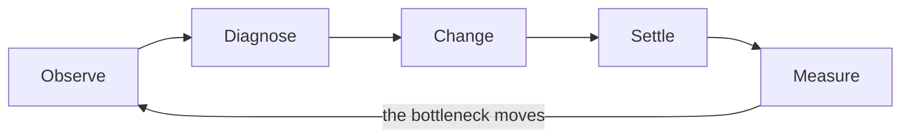
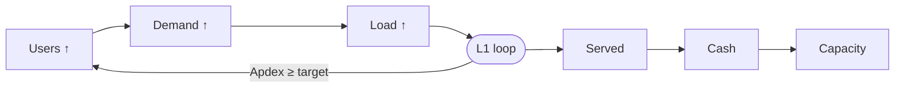
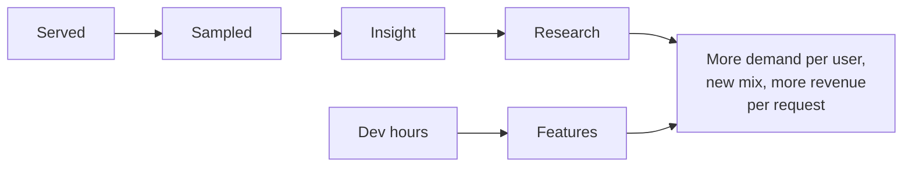
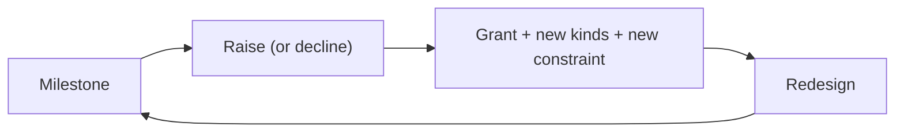
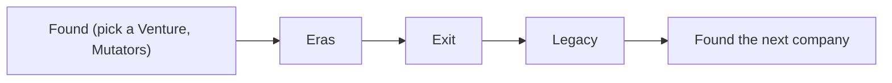
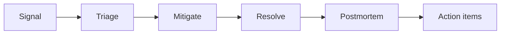

Quorum has six nested loops, and each feeds the one above it. A short loop must pay off before the
player loses interest, and a long loop must give a reason to keep playing the short ones.

| Loop      | Name       | What the player does                             | How long it runs     |
| --------- | ---------- | ------------------------------------------------ | -------------------- |
| L5        | Mastery    | Challenges, daily drills, histograms             | Unbounded            |
| L4        | Company    | Found → Eras → Exit → Legacy                     | 6–15 hours           |
| L3        | Era        | Raise → new kinds → new failure mode             | 30–120 minutes       |
| L2        | Growth     | Users ↑ → demand ↑ → spend → research            | 5–20 minutes         |
| L1        | Bottleneck | Observe → diagnose → change → settle             | 30 seconds–3 minutes |
| L0        | Pulse      | Glance → collect → react                         | 1–10 seconds         |
| Interrupt | Incident   | Alert → triage → mitigate → resolve → postmortem | Whenever one starts  |

## L0: Pulse (1–10 seconds)

The player glances at the board.

1. **Glance.** Particles move. A card turns amber. The $/s number ticks.
2. **Collect.** Revenue piles up in the **Payments** drawer. The player clicks to collect it.
   Research "Stripe Billing" automates this
   ([Progression](/design/10-progression#track-product-and-business)).
3. **React.** The player clicks Upgrade on a red card, or ignores it.

The pulse gives the player a small, satisfying action at any moment. It becomes automatic by the
end of the Garage Era, because a pulse that never changes turns into a chore
([pillar 5](/design/01-vision#pillar-5-respect-the-player)).

## L1: Bottleneck (30 seconds to 3 minutes)

This is the core loop: Factorio's loop, applied to requests.

| Step     | What the player does                                                                          | What the game provides                                                                              |
| -------- | --------------------------------------------------------------------------------------------- | --------------------------------------------------------------------------------------------------- |
| Observe  | Reads the board: load bars, stranded requests, latency, errors.                               | Node cards and the bottleneck marker ([Interface](/design/15-ui-ux#node-cards)).                    |
| Diagnose | Asks why. Is the box out of CPU, out of workers, out of memory, or waiting on the database?   | The diagnosis depends on how much the player can see ([Observability](/design/12-observability)).   |
| Change   | Picks one action: upgrade, place, rewire, change runtime, change a setting, or remove a Node. | Each action has a cost and a Tradeoff card ([Interface](/design/15-ui-ux#tradeoff-cards)).          |
| Settle   | Waits a few seconds while queues drain and caches warm.                                       | The HUD shows "Settling" and then "Stable" ([Interface](/design/15-ui-ux#feedback-after-a-change)). |
| Measure  | Compares $/s, p99, and error rate before and after.                                           | A delta toast, for example "+$1.40/s (+18%), p99 −120 ms".                                          |

Rules that keep this loop deep:

- **One tightest Node.** The simulation is a flow network. At any time, one Node limits each request
  path ([Simulation](/design/04-simulation#the-bottleneck)).
- **Several kinds of bottleneck.** A Node can run out of CPU, workers, memory, connections, disk
  I/O, or network. Each needs a different fix, and more hardware fixes only some of them.
- **Fixes have side effects.** A cache removes database load but adds staleness. A replica adds read
  capacity but adds replication lag. More app servers add database connections.
- **The bottleneck moves both ways.** Faster app servers send more queries to the database, and a
  faster database lets app servers finish sooner, which frees workers.

## L2: Growth (5 to 20 minutes)

- **Users** grow while the design keeps [Apdex](/glossary/apdex) above the Era target, and they
  leave when it drops ([Simulation](/design/04-simulation#users-and-growth)).
- **Cash** buys capacity. **Insight** buys research. **Dev Hours** buy features, migrations, and
  fixes ([Economy](/design/09-economy)).
- **Features** raise revenue and change the request mix. A successful feature creates load, so it
  feeds the L1 loop again ([Team and velocity](/design/08-team-and-velocity#features)).
- Growth follows an S-curve toward the Era's market size, so growth slows near the cap. The player
  needs a new Era, a new feature, or a new region to grow further
  ([Balancing](/design/16-balancing#user-growth)).

## L3: Era (30 to 120 minutes)

An **Era** is a stage of the company, from Garage to Public. When users reach the Era's milestone,
the player can raise a funding round.

Each Era is a phase shift: it changes what the player optimizes.

| Era      | The question the player answers                                    |
| -------- | ------------------------------------------------------------------ |
| Garage   | How far does one box go?                                           |
| Pre-seed | What happens when the database is the bottleneck?                  |
| Seed     | How do I handle work that is not alike: CPU-heavy, abusive, large? |
| Series A | How do I stay up when parts fail, and keep money correct?          |
| Series B | How do I separate analytics from transactions, and scale the team? |
| Series C | How do I serve the whole planet and fan out to millions?           |
| Pre-IPO  | Can I prove reliability and make a profit?                         |
| Public   | Can I beat the quarter, every quarter?                             |

[Progression](/design/10-progression#eras) lists the milestones, grants, kinds, and unlocks.

## L4: Company (6 to 15 hours)

- An **Exit** ends a company. Its payout depends on Equity and valuation
  ([Exit and Legacy](/design/13-prestige#exits)).
- **Legacy** buys permanent perks. Playbooks keep a known-good setup for the next company.
- A **Venture** changes the rules of the next company: its request mix, its constraints, and its
  incidents. A fintech company and a game backend need different designs
  ([Exit and Legacy](/design/13-prestige#ventures)). Every Venture and Mutator is open at founding.

The first company takes 9 to 12 hours. Later companies take 3 to 6 hours, because Legacy speeds
the early Eras and Playbooks remove repeated setup.

## L5: Mastery (unbounded)

- **Challenges.** Fixed puzzles inspired by real events. Each one scores cost, p99, and complexity on
  three histograms ([Challenges](/design/14-challenges)).
- **Daily drill.** A seeded incident that every player gets on the same day.
- **Sandbox.** Guided Sandboxes teach one mechanic each, and the free Sandbox is a test bench. Neither
  feeds the Company ([Sandbox](/design/14-challenges#sandbox)).
- **Public Era quarters.** An endless mode in which the player must beat growth and margin targets
  each quarter ([Progression](/design/10-progression#era-7-public)).
- **Achievements.** Achievements reward knowledge and unusual builds, not hours played.

## Interrupt: the incident loop

Incidents break into any loop from the Pre-seed Era on.

| Step         | Detail                                                                                                                                                             |
| ------------ | ------------------------------------------------------------------------------------------------------------------------------------------------------------------ |
| Signal       | Without alerting, the player notices red cards or a user drop. With alerting, a pager banner appears earlier ([Observability](/design/12-observability#alerting)). |
| Triage       | The player finds the affected Node and the cause.                                                                                                                  |
| Mitigate     | A fast, temporary action: roll back, shed load, block traffic, fail over, or scale up.                                                                             |
| Resolve      | The incident ends, or the cause is removed.                                                                                                                        |
| Postmortem   | The postmortem opens an action item. Until its research is owned, the incident is twice as likely ([Incidents](/design/11-incidents#postmortems)).                 |
| Action items | Optional Dev Hour tasks that prevent the same class of incident, such as idempotency keys or a runbook.                                                            |

## Pacing

Pacing aims for a steady stream of goals, as Factorio does
([Influences](/design/02-influences#factorio)). The times below are for a person playing in real time. The Balanced bot in [Balancing](/design/16-balancing#pacing-model) runs on sim minutes and moves faster, so its Era times do not match this table.

| Phase                      | Time since start | A new goal every | Typical goal                                     |
| -------------------------- | ---------------- | ---------------- | ------------------------------------------------ |
| First minutes              | 0–5 min          | 30–60 s          | Collect, upgrade the box, split the database out |
| Garage                     | 5–20 min         | 1–3 min          | First research, first load balancer              |
| Pre-seed and Seed          | 20 min–2 h       | 2–5 min          | Cache, pooler, queue, first hire, first incident |
| Series A and B             | 2–6 h            | 5–10 min         | Zones, replicas, warehouse, GPU, service split   |
| Series C and Pre-IPO       | 6–10 h           | 10–20 min        | Regions, quorum stores, compliance, cost work    |
| Public and later companies | 10 h+            | 10–30 min        | Quarter targets, Ventures, Challenges            |

The [Balancing](/design/16-balancing#pacing-model) document holds the curves behind these targets and
the scripted players that check them.

## Session shapes

| Session  | Length    | What happens                                                       |
| -------- | --------- | ------------------------------------------------------------------ |
| Short    | 2–10 min  | Fix one bottleneck, collect, queue a Study, leave.                 |
| Standard | 30–60 min | Several bottleneck loops, one Era milestone or one large redesign. |
| Deep     | 2–4 h     | A full Era, a migration, or a Challenge set.                       |

The clock stops when the player closes the Company
([Simulation](/design/04-simulation#the-clock-stops)). A short session therefore ends wherever the
player stopped, and the next one starts there, with no catch-up and no report of what happened while
they were gone. Pacing is measured in play time, so the calendar advances only while they watch.
