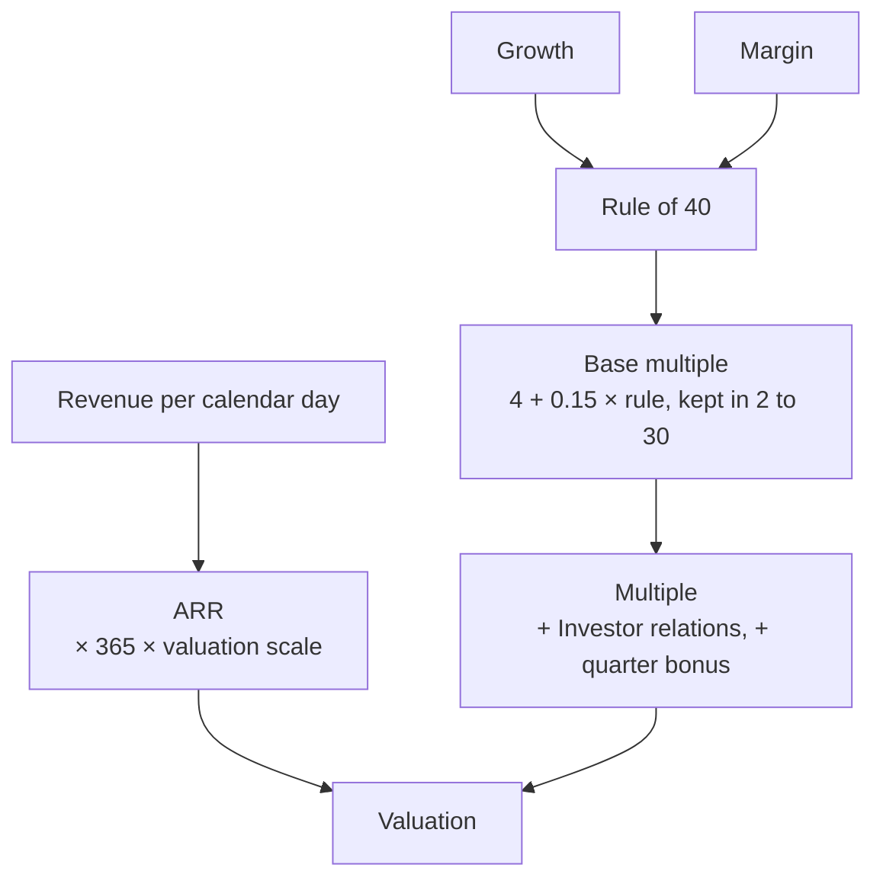
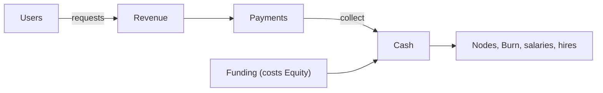
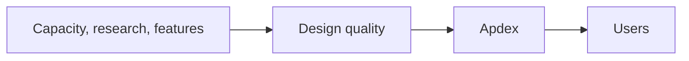
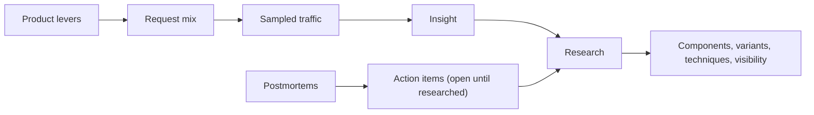
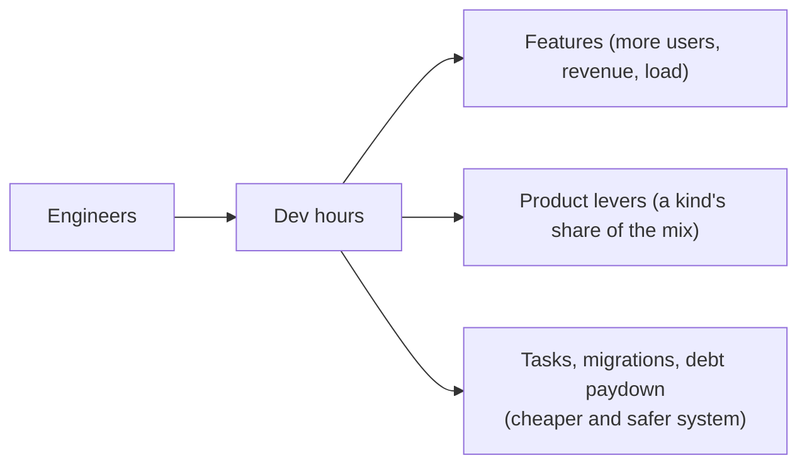
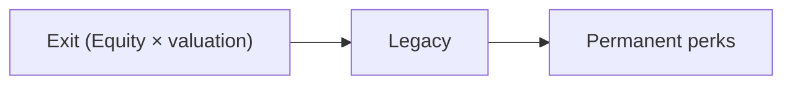

## Currencies

Each currency has one main source and one main sink, so the player always knows what each number
is for.

| Currency  | Symbol | Main source                          | Main sink                                   | Resets on Exit |
| --------- | ------ | ------------------------------------ | ------------------------------------------- | -------------- |
| Cash      | $      | Served requests                      | Nodes, Burn, salaries                       | Yes            |
| Insight   | ◇      | Sampled traffic                      | Research                                    | Yes            |
| Dev Hours | DH     | Engineers                            | Features, product levers, tasks, migrations | Yes            |
| Equity    | %      | Starts at 100%; falls when you raise | Determines the Exit payout                  | Yes            |
| Legacy    | ★      | Exits                                | The Legacy shop                             | No             |

Users are not a currency. They are the state that every currency depends on.

## Cash

### Sources

| Source            | Detail                                                                                                                                                                               |
| ----------------- | ------------------------------------------------------------------------------------------------------------------------------------------------------------------------------------ |
| Request revenue   | `value × Apdex weight` per served request ([Simulation](/design/04-simulation#apdex-and-revenue)).                                                                                   |
| Funding grants    | One grant per round raised ([Funding](#funding)).                                                                                                                                    |
| Subscriptions     | From the Pre-seed Era, the "Paid plans" feature adds a fixed revenue per paying user per calendar day, independent of requests. This makes revenue less spiky and rewards retention. |
| Challenge rewards | None. Challenges pay in Legacy and badges ([Challenges](/design/14-challenges)).                                                                                                     |
| Sandbox rewards   | None. A Sandbox pays nothing in any currency ([Sandbox](/design/14-challenges#sandbox)).                                                                                             |

### The Payments drawer

Revenue first goes to the **Payments** drawer. The player clicks Collect to move it into Cash.

- The drawer holds 60 seconds of revenue at the current rate, at size 1, and never less than $25.
  Each size step doubles it.
- Revenue beyond the drawer's size is lost. The drawer never fills while the clock is stopped, so
  there is no amount to collect after a pause ([Simulation](/design/04-simulation#the-clock-stops)).
- Research "Stripe Billing" (Garage, 30 ◇) collects automatically. After that, the drawer only shows
  the rate.

This keeps the Garage Era active and then removes the click before it becomes a chore
([pillar 5](/design/01-vision#pillar-5-respect-the-player)).

### SLA credits

B2B SaaS Ventures from Series B run under an SLA, a promise of availability one level above the
Era's target ([Ventures](/design/13-prestige#ventures)). While the trailing calendar week sits below
that promise, the Company pays credits back to its customers: 10% of the subscription revenue it is
earning, charged with the Burn. A Company on a 99.95% SLA that misses a week watches Cash fall
faster without a single extra Node on the board.

The credits need `enterprise-sales` research, which signs the contract
([Progression](/design/10-progression#research)). No other Venture signs an SLA, a Venture that has
not reached Series B has not signed yet, and a week that met the target costs nothing. This is the
one place where reliability is a line on the P&L rather than a figure in the HUD
([Incidents](/design/11-incidents#slos-and-error-budgets)).

## The cloud bill

**Burn** is the total Cash spent per second. The HUD shows Cash with its net change per second,
income minus Burn. The Cost panel (`$`) splits Burn into the lines below, with Revenue and the margin
beside them. A data Node's standby is a second box and doubles that Node's Burn; failing over to it
makes the standby the primary and halves the Burn again until the player adds a new standby
([Incidents](/design/11-incidents#mitigation-toolbox)). The table is the bill:

| Line          | Formula                                                                                                                                                                                                                                                                                                               |
| ------------- | --------------------------------------------------------------------------------------------------------------------------------------------------------------------------------------------------------------------------------------------------------------------------------------------------------------------- |
| Compute       | Σ instances `vCPU × $0.05 × family price × pricing model` × cost index; RAM comes with the family                                                                                                                                                                                                                     |
| Managed data  | Σ data Nodes at their size price; a Database adds its provisioned volume and each shard                                                                                                                                                                                                                               |
| Storage       | Object storage: GB stored × price × storage class, plus its retrieval fee ([Data tier](/design/07-data-tier#object-storage))                                                                                                                                                                                          |
| Egress        | GB out × egress price ([Egress](#egress))                                                                                                                                                                                                                                                                             |
| Requests      | API Gateway requests × $0.002, a managed service's price and so not indexed; Serverless Function requests × ($0.00024 + $0.02 per GB-second) × cost index; Edge Function requests × $0.00036 × cost index; Queue tasks × $0.00144 × cost index; Object Storage reads and writes at their product's price × cost index |
| Third parties | Payment fees, Auth Provider per user, LLM tokens, push messages                                                                                                                                                                                                                                                       |
| Observability | Analytics sampling and retention ([Observability](/design/12-observability#the-cost-of-seeing))                                                                                                                                                                                                                       |
| Salaries      | Σ engineers × salary × language factor                                                                                                                                                                                                                                                                                |

Egress, observability, and third-party fees are the lines real teams tend to miss until the invoice
arrives. The Cost panel shows each one on purpose.

### Base prices

| Resource                          | Price                                                                                                                                  |
| --------------------------------- | -------------------------------------------------------------------------------------------------------------------------------------- |
| vCPU, general family              | $0.05/s                                                                                                                                |
| vCPU, family multiplier           | Burstable 0.4×, Compute 0.85×, General 1×, Memory 1.3×, ARM 0.8×                                                                       |
| RAM                               | Implied by the family, inside the vCPU price: 2 GB per vCPU (Burstable, Compute), 4 (General), 8 (Memory)                              |
| Object storage, standard          | $0.000032/s per GB                                                                                                                     |
| Serverless Function request       | $0.00024 per request: Lambda's $0.20 per million × 1,200, so the cost curve crosses where 05 puts it                                   |
| Serverless Function duration      | $0.02 per GB-second, at 1 GB an execution: Lambda's $0.0000166667 × 1,200, charged on the wall time each execution takes               |
| Edge Function request             | $0.00036 per request: Workers' $0.30 per million × 1,200                                                                               |
| Object storage, infrequent access | 0.5× the standard price, and $0.01 per GB read back                                                                                    |
| Object storage, archive           | 0.1× the standard price. A read waits for a restore, and fails as `timeout` until then                                                 |
| Database volume, provisioned IOPS | 1.5× the Database's box                                                                                                                |
| Database rows                     | 3.5× the Object Storage price: gp3 is $0.08 per GB-month against S3 Standard's $0.023. A retention policy multiplies it                |
| Block storage                     | The gp3 price of a Database's rows, and of a Search Engine's index and each replica's copy of it: 3.5× the Object Storage price per GB |
| Queue task                        | $0.00144 per task: SQS's $0.40 per million requests × 3 requests a message × 1,200                                                     |
| Object storage read               | S3 $0.00048, R2 $0.000432 per read: $0.40 and $0.36 per million × 1,200                                                                |
| Object storage write              | S3 $0.006, R2 $0.0054 per write: $5.00 and $4.50 per million × 1,200                                                                   |
| Engineer salary (base)            | $0.40/s                                                                                                                                |

These are Garage prices. Every price in this document, including placement, Burn, egress, and
third-party fees, is multiplied by the Era's cost index, except the Payment Provider's fee, the Auth
Provider's per-user price, and the API Gateway's per-request price. Those three are real-dollar fees
from a managed service, so they stay put while the compute around them rises. The index keeps Burn a
real share of revenue at every size of company. [Balancing](/design/16-balancing#cost-index) holds the index and the salary scale, and
[Balancing](/design/16-balancing#prices) holds the full table.

### How prices map to real prices

Each price follows one of two rules, so a player who knows the real price can check it:

| Rule        | Prices                                                                                                                             | Mapping                                                                          |
| ----------- | ---------------------------------------------------------------------------------------------------------------------------------- | -------------------------------------------------------------------------------- |
| Time-billed | Instances, GPUs, managed Nodes, storage, the Kubernetes control plane, LLM tokens                                                  | $1 per sim second in the game is $1 per real hour. A vCPU is $0.05.              |
| Per use     | Egress, the Payment Provider, push and email messages, Data Warehouse scans, Gateway, function, Queue, and Object Storage requests | The real list price per GB, per checkout, per message, per scan, or per request. |

LLM tokens use the time-billed rule because they compete with GPU Nodes for the same prompts. On
the same scale, a busy H100 is cheaper per prompt than the LLM API only while it is more than half
busy, as in real self-hosting ([Reality check](/design/reality-check#prices)).

Request values set what a user is worth. A user sends about 0.02 requests a second, which on the
time-billed rule is 0.02 an hour in real time, at about $0.25 each, so revenue is about $4 per user
per real month. Meta's 2025 worldwide ARPU was $57 a year, about $4.75 a month. A Product lever's
added requests are marginal: they earn the value of the traffic they displace, so a lever changes the
work, not the revenue per user ([Progression](/design/10-progression#product-levers)).

The two rules disagree, and the gap is deliberate. Per-use prices are about 3,600 times cheaper,
relative to compute, than in a real bill, because at the time-billed rate every page view would pay
half its value in egress. Request values, the cost index, and the salary index are balance controls
and do not follow a real price.

The per-use prices of a function, a Queue, and Object Storage are the exception. The list prices of
Lambda, Workers, SQS, and S3 and R2 are multiplied by 1,200. For a function that puts the crossover
at about 30% of an equal VM's steady load, where
[Components](/design/05-components#serverless-function) puts it. At the straight list prices a
function would never cost as much as the VM it replaces.

## Pricing models

Every Node bills at one rate until the Series A Era. From Series A, each compute Node (an App
Server or a Worker) has a pricing model. The player picks it on the Node's card, and the box price
in the cloud bill is multiplied by it.

Sized compute Nodes take On-demand, Reserved, or Spot. Serverless is not a model on a box. It is the
Serverless Function's own bill: each request and each GB-second on the Requests line, with nothing
standing while it idles ([Components](/design/05-components#serverless-function)).

| Model      | Price   | Condition                                                                                                                                                                                                                                                                                         |
| ---------- | ------- | ------------------------------------------------------------------------------------------------------------------------------------------------------------------------------------------------------------------------------------------------------------------------------------------------- |
| On-demand  | 1.0×    | None. Remove at any time.                                                                                                                                                                                                                                                                         |
| Reserved   | 0.6×    | A commitment of one calendar week. Removing the Node does not stop the Burn until the term ends: selling it early charges the Burn it still owes, and it cannot change model before then.                                                                                                         |
| Spot       | 0.3×    | The provider can reclaim the Node at any time. The player gets a 10-second warning (stylized; the real AWS notice is two minutes). A reclaimed Node goes down for 20 sim seconds. Good for Workers and stateless servers behind a load balancer with spare capacity. Fatal for a single database. |
| Serverless | Per use | Only for Serverless Functions and managed services. A function bills on the Requests line, never as a box.                                                                                                                                                                                        |

The cheapest fleet mixes all three. Reserved instances cover the base load, on-demand instances
cover the daily peak, and spot instances run batch work.

`savings-plans` ([Progression](/design/10-progression#track-cost)) takes a further 20% off every
compute Node's box, on top of whichever model it already runs. It needs no per-Node commitment, so
it is a Company-wide discount and not a fifth model on the card.

## Egress

| Path                          | Price per GB |
| ----------------------------- | ------------ |
| Origin to internet            | $0.09        |
| CDN to internet               | $0.02        |
| Cross-zone, each direction    | $0.01        |
| Cross-region                  | $0.02        |
| Object storage R2 to internet | $0           |

`media` at 5 MB per request makes egress the largest line on the bill in the Series A Era unless a CDN
or R2 serves it. A player who ignores egress sees revenue rise and margin fall.

`egress-optimization` ([Progression](/design/10-progression#track-cost)) moves part of a server's
egress bytes onto the R2 row: $0 instead of the origin price. The part is the share that `upload` and
`media` traffic reaching an R2 Object Storage Node accounts for. The research reads this from the
server's own traffic mix, not a per-byte trace, and only an Object Storage Node that is R2 counts.

## Third-party fees

| Service          | Price                                                      |
| ---------------- | ---------------------------------------------------------- |
| Payment Provider | 2.9% + $0.30 per successful `buy`, not indexed             |
| Auth Provider    | $0.00006/s per user, $0.0864 per calendar day, not indexed |
| LLM API          | $2.50 per 1,000 tokens                                     |
| Push and email   | $0.0001 per message                                        |
| API Gateway      | $0.002 per request, on the Requests line, not indexed      |

## Funding

When users reach an Era milestone, investors offer a round. The player can raise or decline.

| Round    | Milestone (users)                | Grant         | Dilution                 | Notes                                               |
| -------- | -------------------------------- | ------------- | ------------------------ | --------------------------------------------------- |
| Pre-seed | 1,000                            | $2,500        | 10%                      |                                                     |
| Seed     | 5,000                            | $15,000       | 19%                      | Carta median 19.4% (Q2 2026)                        |
| Series A | 25,000                           | $80,000       | 19%                      | Carta median 18.7% (Q2 2026)                        |
| Series B | 150,000                          | $1,500,000    | 13%                      | Carta median 12.9% (2025)                           |
| Series C | 1,000,000                        | $18,000,000   | 12%                      | Carta: 16% median across seed to Series C           |
| Pre-IPO  | 10,000,000                       | $150,000,000  | 12%                      |                                                     |
| IPO      | 50,000,000 and the IPO checklist | Public market | 15% sold in the offering | [Progression](/design/10-progression#era-6-pre-ipo) |

A grant is about 17 sim minutes (1,000 s) of the Burn at the milestone, so it stays worth taking
at every size of company.

**Money buys growth.** An Era that begins with a raised round runs at the full growth rate `g`. An
Era that begins with a declined round runs at 0.7 × `g`, so it takes about 1.4 times as long
([Simulation](/design/04-simulation#users-and-growth)). The player trades Equity for speed.

**Declining** a round keeps Equity and gives no grant. The Era still advances, so the new kinds still
arrive, and the player must pay for them from revenue. A player who declines every round and still
reaches IPO earns the achievement "Default Alive", named after Paul Graham's essay. The pacing bots
check that this path does not beat the raise-every-round path in Legacy per hour
([Balancing](/design/16-balancing#pacing-model)).

Dilution compounds. A founder who raises every round keeps about
0.90 × 0.81 × 0.81 × 0.87 × 0.88 × 0.88 ≈ 39.8% before the IPO offering and about 33.8% after it,
which is above a typical real founder stake at IPO.

## Valuation

The company has a valuation at all times. It decides the Exit payout.

```latex
\begin{aligned}
\text{ARR} &= \text{revenue per calendar day} \times 365 \times \text{valuation scale} \\
\text{rule of}\ 40 &= \text{growth} + \text{margin} \\
\text{base} &= 4 + 0.15 \times \operatorname{max}\left(0{,}\ \text{rule of}\ 40\right) && \qquad \text{clamped to [2, 30]} \\
\text{multiple} &= \operatorname{max}\left(1{,}\ \text{base} + 2\ \text{with Investor relations} + \text{the quarter's bonus}\right) \\
\text{valuation} &= \text{ARR} \times \text{multiple}
\end{aligned}
```

| Term   | Meaning                                                         |
| ------ | --------------------------------------------------------------- |
| growth | User growth over the last calendar week, annualized, in percent |
| margin | (income − Burn) / income, in percent                            |



The clamp applies to `base` only. Investor relations adds 2 to the multiple, and a public quarter
adds its bonus, from −10 to +10 ([Progression](/design/10-progression#era-7-public)), so either can
take the multiple past 30.

`valuation_scale` is 1.5 × 10⁻⁴. Request values are stylized game dollars, so Cash and revenue run
far above real figures. The scale converts a year of game revenue into the real-dollar ARR that the
company would report ([Balancing](/design/16-balancing#valuation-scale)). The Valuation, Exit payout,
and Legacy use real dollars. Cash, revenue, and Burn use game dollars.

The [Rule of 40](/glossary/rule-of-40) is a real heuristic for software companies: growth plus
profit margin should be at least 40%. It gives the late game a reason to care about margin, not only
growth.

## Runway and running out of Cash

**Runway** is Cash divided by net Burn.

The HUD shows runway beside Cash's net change in 30-day months while net Burn is positive, and the
Dashboard's Company panel shows the same figure. What happens at zero is a sequence of events.

When Cash reaches zero:

1. Placement and upgrades stop, and so does hiring: nothing that costs Cash starts until the balance
   is positive again. Selling Nodes, layoffs, Research, the backlog, and the Payments drawer keep
   working, and Burn keeps billing.
2. Burn continues and Cash goes negative.
3. At −1 calendar day of Burn, investors offer a **bridge**: a grant that is 3 calendar days of Burn
   for 8% dilution. The player can accept, or cut costs. The terms are fixed when the offer arrives,
   and the Company is offered one bridge.
4. If the player declines (leaves the offer unanswered) and Cash reaches −3 calendar days of Burn,
   Nodes shut down, most expensive first, until net Burn is zero. A shut Node serves nothing, bills
   nothing, and stays on the board until the player sells it or pays to replace it.

Running out of money is a setback and the Company continues
([pillar 5](/design/01-vision#pillar-5-respect-the-player)). The Company row of the Dashboard shows
the bridge's grant, dilution, and Accept while the offer waits
([Interface](/design/15-ui-ux#company-and-incidents-panels)).

Some details of the thresholds, the grant, the dilution, and the shutdown:

- The two thresholds count the gross Burn, which this document calls Burn. The shutdown counts net
  Burn, which this document names.
- "Most expensive" is the Node with the highest Burn now, excluding Users, Payments, and any Node
  already shut.
- The grant is fixed at the offer's Burn, like a term sheet, so later cost cuts do not shrink it.
- The 8% comes off the Equity the founder holds at the time, so two bridges would compound; the
  build offers one.

## Sources and sinks summary











The three main currencies (Cash, Insight, Dev Hours) compete for the player's attention, not for
each other. Nothing converts one into another directly. Dev Hours build a Product lever, the lever
changes the mix, the mix changes sampled traffic, and traffic earns Insight, so the only bridge is a
production chain with a capacity bill. That keeps each choice legible.
