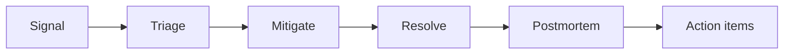

An **Incident** is an event that stresses the design, and incidents are the game's tests. Each one
checks whether the design survives a real failure mode that its Era makes likely.

## Design rules

1. **Attack the design, not the player.** The incident director prefers incidents that hit a real
   weakness in the current design: a single point of failure, a missing timeout, an unbounded queue.
   A well-built design survives most incidents with no action. This applies the Factorio lesson that
   problems should come from the player's own choices ([Influences](/design/02-influences#factorio)).
2. **Readable in seconds.** Every incident has a visible signal on the board within 5 seconds.
3. **Real.** Every incident type is a real class of outage, and most cite a real event.
4. **Survivable.** No incident ends a company. The worst case is lost users, lost Cash, and a lower
   valuation.
5. **Nothing runs while the Company is closed.** The clock stops, so an incident never runs
   unattended and the player never returns to damage
   ([Simulation](/design/04-simulation#the-clock-stops)).
6. **One at a time, early.** Before Series A, at most one incident runs at a time. From Series A a
   cascade is possible, because cascades are what real large outages look like: an incident nobody
   answers starts a second one when it ends ([Cascades](#cascades)). Even then only one runs at a
   time.

## The incident director

The director picks the next incident and its time.

```latex
\begin{aligned}
\text{time between incidents} &= \text{base interval} \left(\text{Era}\right) \times \operatorname{random}\left(0.6,\ 1.4\right) \\
\text{weight} \left(\text{type}\right) &= \text{weakness} \left(\text{type} ,\  \text{design}\right) \times \left(1 + \text{tech debt}\right)
\end{aligned}
```

There is no per-type base weight: every incident the Era allows starts from the same weight, before
weakness.

| Era      | Base interval (sim time) | Highest starting severity |
| -------- | ------------------------ | ------------------------- |
| Garage   | None                     | None                      |
| Pre-seed | 12 min                   | SEV2                      |
| Seed     | 10 min                   | SEV2                      |
| Series A | 9 min                    | SEV2                      |
| Series B | 8 min                    | SEV1                      |
| Series C | 8 min                    | SEV1                      |
| Pre-IPO  | 10 min                   | SEV1                      |
| Public   | 10 min                   | SEV1                      |

A Venture can add a **signature incident** of its own ([Exit and Legacy](/design/13-prestige#ventures)).
Each Venture meets one:

- Big tenant hot shard for B2B SaaS.
- Hot key for Consumer social.
- Double charge for Fintech.
- Premiere spike for Streaming media.
- Launch day for Game backend.
- GPU shortage for AI startup.
- Flash sale for E-commerce.
- Retry storm for Developer platform.
- Audit finding for Healthcare.
- Latency regression for Ad tech.
- Deadline day for Government contract.

Bootstrapped indie has none: its row names Runway, a figure rather than an incident.

A signature incident weighs four times as much for its Venture and keeps a weakness of 2, so it fires
even on a solid design. Six are signatures only: Latency regression, Deadline day, Big tenant hot
shard, Premiere spike, Launch day and Flash sale. Another Venture's weakness never starts them, and
they weigh 0 for every other Company. The other five are general incidents that their Venture meets
four times as often.

`weakness(type, design)` is 0.2 to 3.0. For example, "Instance failure" has weakness 3.0 when a
critical path has a single Node and 0.5 when every Node on it has a redundant copy in another zone.
0.2 is only the floor that every possible incident keeps. The director works as a teacher, because
it keeps showing the player their weakest point.

**Severity.** SEV3 affects one Node or one kind. SEV2 affects a service or a zone. SEV1 affects the
whole company or a region. An arrow in the catalog, such as "3→2", means the incident escalates once, halfway through, if it
has hurt users for more than half its run so far. It steps to the severity the arrow names, its
remaining time is multiplied by 1.5, and a traffic spike's demand is multiplied by 1.5 too. An incident with no arrow has no second severity. The director never starts an incident above
the Era's highest starting severity.

**Duration.** Incident durations are in calendar time, because the SLO is. One sim second is one
calendar minute. Before Series A, each incident runs for the playtest duration in its catalog entry,
between 30 and 300 sim seconds. From Series A, when the error budget counts, an unmitigated incident
lasts at most its starting severity's calendar duration:

| Starting severity | Sim seconds | Calendar time |
| ----------------- | ----------- | ------------- |
| SEV3              | 5           | 5 minutes     |
| SEV2              | 20          | 20 minutes    |
| SEV1              | 60          | 60 minutes    |

An SRE team with an engineer on it restores service 40% faster, so every duration in this document,
and the recovery it drives, runs 60% as long ([Team](/design/08-team-and-velocity#teams)).

Only failed requests spend the error budget, so a design with spare capacity or redundancy loses
little or nothing.

## The incident loop



| Metric | Meaning                                                         | Shown after |
| ------ | --------------------------------------------------------------- | ----------- |
| MTTD   | Mean time to detect: from the start to the first signal         | Always      |
| MTTA   | Mean time to acknowledge: from the first signal to the response | Always      |
| MTTR   | Mean time to restore service                                    | Always      |

An Incident records the sim second its first signal lands and the sim second a player first acts on
it. Its Postmortem, its card and the Incidents panel show MTTD, MTTA and MTTR beside each other. MTTD
is measured from the start and MTTA from the signal. Either may be unknown: a run that never
signalled, and one nobody answered, show a dash. A Game saved without the fields decodes them as
unknown, so an old save opens with dashes and loads.

The signal is the pager when the Company has researched `alerting`: the Step a rule's threshold is
crossed. Without it the board is the first signal, and the board shows trouble only when requests
fail, at the same 1% the errors rule watches. The pager also catches an incident that has not failed
a request yet but has pushed p99 or saturation past its threshold, which is where alerting earns its
Insight.

The acknowledgement is the player's first action while the Incident runs. Any action counts, because
it means the player is at the board. With `on-call` a rotation answers the page instead, five sim
seconds (five calendar minutes) after it lands, so a Company with a rotation logs a five-minute MTTA
whether or not the player was watching. `anomaly-detection` halves the hold before the pager fires,
so the page lands earlier.

**Who it pages, and what a page costs.** An Incident pages the team that owns the Service whose code
failed ([Team](/design/08-team-and-velocity#services)). Every page is recorded against the engineers
on that team and takes a little of their mood. That is how a bad quarter on call turns into a
resignation, and why the three answers to an unhappy engineer include time off
([Mail](/design/18-mail#teammates)). A Company with no engineer on the owning team pages nobody, so
the Garage founds alone.

## Catalog

| Incident                    | Era      | Sev | Trigger and weakness                                                                                              | Symptoms on the board                                                        | Mitigation                                     | Prevention                                                                         | Real reference                                                              |
| --------------------------- | -------- | --- | ----------------------------------------------------------------------------------------------------------------- | ---------------------------------------------------------------------------- | ---------------------------------------------- | ---------------------------------------------------------------------------------- | --------------------------------------------------------------------------- |
| Traffic spike               | Pre-seed | 3→2 | A link on a big news site. Weak: no spare capacity                                                                | Demand ×3 to ×10 for minutes. Every card amber, then red                     | Scale up, shed load, serve cached pages        | Autoscaler, CDN, load shedding                                                     | The "Slashdot effect" and "hug of death"                                    |
| Deadline day                | Seed     | 2→1 | A Government contract's deadline lands. Weak: no capacity held for it (13)                                        | Demand ×3 for minutes; every card amber, then red                            | Shed load, scale up                            | Reserved capacity, a Queue for the deadline work, load shedding                    | Tax-filing and benefits-enrolment deadlines                                 |
| Instance failure            | Pre-seed | 3→2 | The host under a VM dies. Weak: single Node on a path                                                             | One card goes grey. Stranded requests                                        | Replace the Node, or fail over to its standby  | Redundancy, health checks                                                          | Cloud providers retire degraded hosts routinely                             |
| Bad deploy                  | Pre-seed | 3→2 | A deploy ships a bug. Weak: recreate deploys, no tests                                                            | Error rate jumps right after a deploy                                        | Roll back                                      | Canary, feature flags, tests                                                       | Knight Capital lost about $440M in 45 minutes after a bad deploy (2012)     |
| Slow query                  | Pre-seed | 3→2 | A feature added an unindexed query. Weak: large tables                                                            | Database CPU climbs with data volume                                         | Add index                                      | Code review, query analysis                                                        | Common                                                                      |
| Connection exhaustion       | Pre-seed | 2→1 | App servers or functions scaled out. Weak: no pooler                                                              | `refused` errors on the database                                             | Reduce pool size, remove app servers           | Connection Pooler                                                                  | PostgreSQL "too many clients already"                                       |
| Memory leak                 | Pre-seed | 3→2 | A persistent runtime leaks. Weak: no periodic restarts                                                            | RSS climbs over uptime, then `oom` and a cold restart                        | Restart the service                            | `max_requests` restarts, "Fix memory leak" task, PHP-FPM                           | Common in long-running processes                                            |
| Event loop block            | Pre-seed | 3→2 | A CPU-heavy kind on an event loop                                                                                 | p99 rises on every kind on that service                                      | Move the kind to another service               | Worker threads, async crypto                                                       | Node.js "Don't block the event loop" guide                                  |
| Data breach                 | Pre-seed | 1   | An expired patch ticket is exploited, not the director. Weak: a patch that waits past its deadline                | Users fall 15% at once; the ticket is gone and a Mail arrives                | None: it runs its course                       | Dependency scanning, a Security team                                               | The Equifax breach, 2017                                                    |
| Credential leak             | Pre-seed | 1   | A phishing Mail is acted on, not the director. Weak: a trap the player clicks                                     | Users fall 10% at once; the pager writes, and the trap's thread records it   | None: it runs its course                       | Reading the sender's domain; Secrets management; reporting the Mail as spam        | A fake console page asking for root keys                                    |
| Bot surge                   | Seed     | 3→2 | Scrapers. Weak: no WAF                                                                                            | `bot` share rises to 50%                                                     | Block at the edge                              | WAF, rate limits                                                                   | Common                                                                      |
| Credential stuffing         | Seed     | 2→1 | Bots try leaked passwords on `login`. Weak: no limits                                                             | `login` volume ×20, CPU pinned by bcrypt                                     | Rate-limit `login`                             | Credential protection, Auth Provider                                               | Common                                                                      |
| Cache stampede              | Seed     | 2→1 | A hot key expires or the cache restarts                                                                           | Database load spikes when cache hit ratio falls                              | Throttle, warm the cache                       | Stampede protection                                                                | Facebook's 2010 outage involved a cache and database feedback loop          |
| Certificate expired         | Seed     | 2→1 | Calendar date, or a Secrets and Certificates Node left down. Weak: no automation                                  | Every TLS Node fails at once                                                 | Renew                                          | Certificate automation                                                             | Many large services have had certificate-expiry outages                     |
| Disk full                   | Seed     | 2→1 | Logs or WAL fill a disk                                                                                           | Database writes fail                                                         | Expand the volume                              | Retention, alerts on disk                                                          | Common                                                                      |
| Poison message              | Seed     | 3→2 | A job that always fails. Weak: no dead-letter queue                                                               | Queue depth climbs forever; Workers busy                                     | Delete the message                             | Dead-letter queue, max attempts                                                    | Common                                                                      |
| Regex backtracking          | Series B | 1   | A WAF rule with catastrophic backtracking                                                                         | WAF CPU 100% on every Node                                                   | Disable the rule                               | Canary rule rollouts                                                               | Cloudflare global outage, 2 July 2019                                       |
| DDoS                        | Seed     | 2→1 | An attacker floods the edge                                                                                       | Demand ×50 of junk                                                           | Enable "Under attack" mode (challenge all)     | WAF, CDN, Anycast                                                                  | Common                                                                      |
| Zone outage                 | Series A | 2→1 | A zone fails. Weak: single-zone services                                                                          | All Nodes in one zone go grey                                                | Fail over                                      | Multi-zone with spare capacity                                                     | Several AWS us-east-1 events                                                |
| Retry storm                 | Series A | 2→1 | A brief slowdown plus naive retries. See [below](#retry-storm)                                                    | Load keeps rising after the trigger ends                                     | Open circuit breakers, shed load               | Backoff with jitter, circuit breakers, retry budgets                               | Metastable failures (HotOS 2021, OSDI 2022)                                 |
| Latency regression          | Series A | 3→2 | A deploy adds one synchronous call to every request. Weak: every kind on the path (13)                            | Every kind slows by 150 ms; bids past 100 ms earn nothing                    | Roll back, fix the path                        | Percentiles, tracing, and a canary that watches p99                                | Latency regressions that follow a deploy                                    |
| Flash sale                  | Series A | 2→1 | The monthly sale lands. Weak: no capacity held for checkouts (13)                                                 | `buy` demand ×20 for minutes; the Database and the Payment Provider saturate | Queue checkouts, scale up                      | A Queue for the checkout work, an Autoscaler, load shedding                        | Black Friday and flash sales                                                |
| Premiere spike              | Series A | 2→1 | A premiere drops. Weak: no spare video capacity (13)                                                              | `media` demand ×4 for minutes; the CDN and egress saturate                   | Shed load, scale the video path                | Tiered caching, reserved capacity, load shedding                                   | Premieres and live events                                                   |
| Launch day                  | Series A | 2→1 | A game launches. Weak: a Hub sized for the steady state (13)                                                      | `rt` demand ×6; every client connects at once                                | Scale the Hubs, shed load                      | Realtime Hubs sized for the peak, reconnect jitter, load shedding                  | Launch-day outages in game backends                                         |
| Replication lag             | Series A | 3→2 | Heavy writes                                                                                                      | `stale` errors after writes                                                  | Route reads to the primary                     | Read-your-writes routing, sync replica                                             | Common                                                                      |
| Payment provider outage     | Series A | 2→1 | The provider fails. Weak: one provider                                                                            | `buy` fails as `upstream`                                                    | Queue checkouts for later, show a banner       | A second provider, a queue                                                         | Third-party outages are routine                                             |
| Double charge               | Series A | 2→1 | A timed-out `buy` retried. Weak: no idempotency keys                                                              | `duplicate` errors, refunds                                                  | Stop retries on `buy`                          | Idempotency keys                                                                   | Why payment APIs require idempotency keys                                   |
| Forced cluster upgrade      | Series A | 2→1 | A Cluster left on a version the provider no longer supports. Weak: a Cluster a quarter or more behind             | Pods that use removed APIs crash-loop                                        | Upgrade the Cluster                            | Upgrade at least once a quarter, or a Platform team                                | Kubernetes removes deprecated APIs on a schedule                            |
| Spot reclaim                | Series A | 3→2 | The provider needs the capacity back. Weak: a spot Node on the request path                                       | One Node goes grey after a 10 s warning                                      | Switch it to on-demand                         | Mixed fleets, graceful shutdown                                                    | Spot interruption notices                                                   |
| Reconnect storm             | Series A | 2→1 | A Realtime Hub restarts. Weak: no reconnect jitter                                                                | All clients reconnect in one second; the Hub refuses what it cannot take     | Throttle connects, or wait for the Hub to warm | Reconnect jitter, Clustering                                                       | Common                                                                      |
| JVM warmup under load       | Seed     | 3   | Scaling up Java during a spike. Weak: an Autoscaler that adds cold copies                                         | New copies make p99 worse for 30 s                                           | Wait, or route less traffic to new copies      | Slow start on the Load Balancer, scheduled scaling, native image                   | Common                                                                      |
| GC pause storm              | Series A | 3→2 | Heap above 90% on a GC runtime                                                                                    | p99 spikes; p50 normal                                                       | Restart, resize                                | More memory, ZGC, GOGC tuning                                                      | Discord's Go read-states service (2020)                                     |
| Hot key                     | Series C | 2→1 | One key or tenant gets a huge share                                                                               | One shard or cache node red, others idle                                     | Cache the key locally                          | Key splitting, hybrid fan-out                                                      | Celebrity posts                                                             |
| Report kills the database   | Series B | 2→1 | `report` runs on the primary                                                                                      | Every kind slows down                                                        | Disable reports                                | Data Warehouse                                                                     | Common                                                                      |
| Schema migration lock       | Series A | 2   | An `ALTER TABLE` on a big table. Weak: large tables and no online migrations                                      | Writes queue and time out                                                    | Cancel the migration                           | Online migrations, expand and contract                                             | Common                                                                      |
| GPU shortage                | Series B | 3→2 | No H100 capacity this month                                                                                       | GPU Nodes cannot be placed                                                   | Use the LLM API or smaller GPUs                | Reserved GPU capacity                                                              | 2023–2024 GPU supply shortage                                               |
| Big tenant hot shard        | Series B | 2→1 | One big tenant's key lands on one shard. Weak: one Database serving a large tenant (13)                           | One shard red, the others idle; every kind on that Database slows            | Cache the tenant's reads, split its key        | Sharding, and a Cache in front of the Database                                     | Noisy-neighbour tenants in a sharded database                               |
| Supply-chain compromise     | Series B | 1   | A malicious package version. Weak: no dependency scanning                                                         | A service exfiltrates data; reputation falls                                 | Pin and redeploy                               | Dependency scanning, Deno permissions                                              | event-stream (2018), xz-utils backdoor (2024)                               |
| Runaway bill                | Series A | 2→1 | An Autoscaler grows to its ceiling with no spike to serve. Weak: a high ceiling                                   | Burn rises with no extra revenue                                             | Lower the Autoscaler ceiling                   | A low ceiling, budget alerts                                                       | Many public "surprise cloud bill" reports                                   |
| Stale reads                 | Seed     | 2→1 | A Cache serves values past their TTL. Weak: a long TTL on write-heavy data                                        | `stale` errors on API reads and checkouts                                    | Shorten the TTL                                | A shorter TTL, write-through, read-your-writes routing                             | Common cache-invalidation bugs                                              |
| MTU mismatch                | Series A | 2→1 | A partner path has a smaller MTU. Weak: large uploads                                                             | `upload` times out on the way in                                             | Clamp the packet size                          | One network for large uploads                                                      | Path-MTU discovery failures                                                 |
| Accidental delete           | Series B | 2   | An operator deletes data. Weak: a Database with no restorable backup                                              | A table disappears                                                           | Restore from backup                            | PITR, restore drills                                                               | GitLab database deletion incident (2017)                                    |
| Region outage               | Series C | 1   | A whole region fails                                                                                              | One region board goes grey                                                   | Fail over to another region                    | Multi-region                                                                       | Large cloud regions have had multi-hour outages                             |
| Network partition           | Series C | 1   | Regions lose contact for seconds                                                                                  | Split brain on leader-based stores; writes diverge                           | Fence the old leader                           | Consensus stores, careful failover                                                 | GitHub's 43-second partition led to a 24-hour degradation (21 October 2018) |
| DNS or BGP misconfiguration | Series C | 1   | A routing change withdraws the company from the internet                                                          | Users cannot reach any region                                                | Roll back the change                           | Change review, staged rollouts                                                     | Facebook outage, 4 October 2021                                             |
| Bad config push             | Series C | 1   | A config update reaches every App Server and Worker at once                                                       | They crash together; with GitOps all at once, in every mirrored region too   | Roll back                                      | Staged config rollouts, GitOps Staged ([Components](/design/05-components#gitops)) | CrowdStrike update failure, 19 July 2024                                    |
| Operator typo               | Series C | 2   | A command removes more capacity than intended. Weak: no plan to review                                            | A data Component loses most Nodes                                            | Re-add capacity, restart                       | Safeguards on capacity removal                                                     | Amazon S3 us-east-1 outage, 28 February 2017                                |
| Leap second or clock skew   | Series C | 1   | Clocks jump. Weak: no leap smear on the clocks                                                                    | Timeouts and lock errors across a region                                     | Restart affected Nodes                         | Leap smearing                                                                      | The 2012 leap second caused outages at several sites                        |
| Audit finding               | Pre-IPO  | 3→2 | A SOC 2 auditor finds a gap                                                                                       | An IPO checklist item resets                                                 | Fix within the calendar week                   | Security team                                                                      | Compliance work                                                             |
| DR drill                    | Pre-IPO  | 1   | The player runs a drill, not the director: the home region fails for 60 s                                         | The home region goes grey; reads and writes must move                        | Fail over, and get errors back under 1%        | `dr-drills`, Multi-region, GeoDNS, and data in both regions                        | The quarterly DR drill                                                      |
| Table bloat                 | Series A | 2→1 | Heavy updates outrun `VACUUM` on PostgreSQL. Weak: a Database that keeps every row                                | Reads and writes on one Database cost 2× the CPU                             | None: it runs its course                       | A retention window, or the MySQL engine                                            | Common PostgreSQL operations failure                                        |
| Cached page leak            | Series A | 1   | A CDN's cache key leaves out the cookie while Edge-side includes cache logged-in pages                            | Users fall 5% at once; one user's page reached another                       | None: it runs its course                       | A cache key that holds the cookie                                                  | Steam store cached-page leak (December 2015)                                |
| Stale OPcache               | Pre-seed | 3   | A deploy does not reset OPcache. Weak: a busy PHP App Server with OPcache and no CI/CD Pipeline                   | The Node fails 30% of its requests with the old code on the new schema       | Restart the Node                               | A CI/CD Pipeline, which resets the cache on every deploy                           | PHP with `validate_timestamps=0` keeps running the old code                 |
| Library incompatibility     | Seed     | 3   | A library does not survive gevent's monkey patching. Weak: a busy gevent App Server and no `testing-culture`      | The Node fails 15% of its requests                                           | Restart the Node                               | `testing-culture`                                                                  | Libraries that break under gevent monkey patching                           |
| Runtime compatibility       | Series A | 3   | A package that works on Node.js does not work on Bun. Weak: a busy Bun App Server and no `testing-culture`        | The Node fails 20% of its requests                                           | Restart the Node                               | `testing-culture`                                                                  | Packages that run on Node.js and fail on Bun                                |
| Split brain                 | Series B | 2→1 | A partition cuts a Distributed Erlang cluster in two. Weak: a busy Elixir Realtime Hub and no `chaos-engineering` | Half of the Hub's realtime messages fail as `stale`                          | Restart the Node, which rejoins the cluster    | `chaos-engineering`                                                                | Split-brain failures in clustered systems                                   |

## The six kinds

Ten kinds in the catalog above need more detail than a row holds, so this table gives the Era,
severity, duration and weakness of each. The heading keeps its old anchor, which other pages link to.

| Kind                      | Era      | Sev | Sim s | Trigger in the build                                                                           | Effect in the build                                                                | Mitigation           | Action item                   |
| ------------------------- | -------- | --- | ----- | ---------------------------------------------------------------------------------------------- | ---------------------------------------------------------------------------------- | -------------------- | ----------------------------- |
| JVM warmup under load     | Seed     | 3   | 30    | A busy Java App Server an Autoscaler can add copies to (weakness 3, else 1)                    | The Node answers at its runtime's cold speed, 30% on Tomcat, until the warmup ends | Wait, or drain it    | `graal-native`, `autoscaling` |
| Stale OPcache             | Pre-seed | 3   | 90    | A busy PHP App Server with OPcache; 1.5, or 0.3 with a CI/CD Pipeline, which resets the cache  | The Node runs the old code against the new schema and fails 30% of its requests    | Restart the Node     | `ci`                          |
| Library incompatibility   | Seed     | 3   | 90    | A busy gevent App Server; 1, or 0.3 with `testing-culture`                                     | The Node fails 15% of its requests                                                 | Restart the Node     | `testing-culture`             |
| Runtime compatibility     | Series A | 3   | 90    | A busy Bun App Server; 1, or 0.3 with `testing-culture`                                        | The Node fails 20% of its requests                                                 | Restart the Node     | `testing-culture`             |
| Split brain               | Series B | 2→1 | 90    | A busy Elixir Realtime Hub in a Distributed Erlang cluster; 1, or 0.3 with `chaos-engineering` | Half of its realtime messages fail as `stale`                                      | Restart the Node     | `chaos-engineering`           |
| Schema migration lock     | Series A | 2   | 150   | The busiest Database; 2.5 without `online-migrations`, 0.3 with it                             | Writes on that Database fail as `timeout` until the migration is cancelled         | Cancel the migration | `online-migrations`           |
| Supply-chain compromise   | Series B | 1   | 90    | A busy App Server; 2 without `dependency-scanning`, 0.5 with it                                | Users fall 10% at once as the reputation goes                                      | Pin and redeploy     | `dependency-scanning`, `deno` |
| Accidental delete         | Series B | 2   | 120   | The busiest Database; 3 with no backup or a broken one, 0.5 with `restore-drills`              | Its reads and writes fail as `refused` until the table is restored                 | Restore from backup  | `pitr`, `restore-drills`      |
| Operator typo             | Series C | 2   | 120   | A data Component serving now; 2 without `infra-as-code`, 0.5 with it                           | Every Node of that Component in its region goes down                               | Re-add capacity      | `infra-as-code`               |
| Leap second or clock skew | Series C | 1   | 60    | A busy App Server, whose region is the one the jump hits; 1.5 without `leap-smearing`          | Every Node there answers 1,000 ms late, and 10% of its answers time out            | Restart the Nodes    | `leap-smearing`               |

The JVM warmup lasts 30 s, which is also Tomcat's warmup (06 "Java"). The other durations are 150, 90,
120, 120 and 60 sim seconds. A supply-chain compromise and a restore with no good backup drive away 10%
of the Users, and a clock jump adds 1,000 ms to every hop and times out 10% of answers.

A restore with no good backup loses users because the rows in the deleted table are gone (07
"Backups"): `pitr` and `restore-drills` are what make the restore succeed. Restarting the Nodes a clock
jump hits is one action, because the jump is the region's, not one Node's.

## Cascades

From Series A, an incident that is **left alone** can start a second one. Left alone means nobody
answered it, neither the player's first action nor an on-call rotation, and it ran its whole clock
rather than ending early. A response, a drain, a runbook, or an answer of any kind ends that
possibility, because the incident was handled.

A cascade starts **after** its cause, never beside it: the director keeps one incident at a time, so the
cause files its postmortem and the second incident begins the same Step. It holds the director's clock
too, so the next incident waits for the cascade to end and the usual gap after it. The second one
records its cause, and its postmortem does too, so the incident bar names the chain and the
postmortem Mail says what it followed.

Each pair is a failure that the [flagship incidents](#flagship-incidents) already describe:

| Left alone                    | Starts                |
| ----------------------------- | --------------------- |
| Traffic spike                 | Connection exhaustion |
| Slow query, or migration lock | Retry storm           |
| Retry storm                   | Connection exhaustion |
| Cache stampede                | Slow query            |
| Memory leak                   | GC pause storm        |
| Hot key                       | Cache stampede        |
| Accidental delete             | Replication lag       |
| Leap second or clock skew     | Network partition     |

A chain stops after one hop: a cascaded incident carries its cause, and one that carries a cause never
starts another. The second incident must also have something to hit, so a Design with none of the second
kind's weakness ends the chain there. A kind the director never starts on its own (a Data breach, a
Credential leak, a DR drill) is never a cascade either, because only the player starts one. Before
Series A, and in a Sandbox, no cascade happens at all.

## Flagship incidents

### Retry storm

The incident that teaches metastable failure.

1. A trigger: a 20-second slowdown on one data Node.
2. Callers time out and retry at once (naive retries, up to 3).
3. Load on the slow Node rises to nearly 4× while it recovers.
4. The trigger ends, but the Node stays overloaded, because retries keep it full.
5. Timeouts upstream cascade to other services.

The player can stop it by opening circuit breakers, shedding load, or temporarily removing traffic
until queues drain. The lesson is that the stable state of an overloaded system with retries can be
"overloaded" ([Simulation](/design/04-simulation#retries)).

### Cache stampede

1. A cache Node restarts or a hot key expires.
2. Hit ratio falls from 90% to 0%.
3. The database receives 10× its normal reads and saturates.
4. Requests that refill the cache time out, so the cache stays cold.

Mitigation: limit traffic until the cache fills. Prevention: stampede protection and cache warming
([Data tier](/design/07-data-tier#stampedes)).

### Bad deploy

Bad-deploy chance per deploy:

```latex
\begin{aligned}
\text{chance} &= \text{base} \left(\text{Era}\right) \times \text{policy factor} \times \left(1 + 2 \times \text{tech debt}\right) \\ &\quad \times \left(1 - \text{tests}\right) \times \left(1 - \text{code review}\right)
\end{aligned}
```

From Pre-seed, the chance also adds 10 points for every full rushed Feature in the batch, scaled by
the share of its cost the pool paid, and the result is capped at 100%.

The blast radius depends on the deploy batch ([Components](/design/05-components#cicd-pipeline)): a bad
deploy fails 8% of App Server requests for each Feature in the batch it shipped. The ceiling on that
share is the CI/CD Pipeline's deploy strategy: 40% without a Pipeline and on Rolling, 100% on
Recreate, 10% on Blue-green and 5% on Canary. A rolling Cluster deploy stops after its first batch
of pods, so pods there take a quarter of that.

**Whose traffic it breaks.** A bad deploy belongs to the Service that shipped it
([Services](/design/08-team-and-velocity#blast-radius)). Each Service's deploy ships only its own
Features, so the batch that breaks is that Service's last deploy, and the kinds its Features put on
the wire fail while every other Service keeps serving. A Company with one Service breaks every kind,
which is also how an old save loads. The incident and its postmortem name the Service and the team
that owns it.

Feature Flags set a ceiling of their own ([Components](/design/05-components#feature-flags)). A
Feature only breaks the effective share of users its flag has reached, and a flag change propagates to
every server in seconds. A batch of thirteen
Features at 5% breaks 5.2% of requests under Recreate, Rolling, and Blue-green once the change has
propagated. Canary's 5% holds it
to 5. A Feature with no flag is live for every user, as an old save opens. The rollout does not
scale the Feature's load, and a Feature's code is never removed.

## Mitigation toolbox

Actions the player can take during an incident. Most need research.

| Action               | Effect                                                                        | Research           |
| -------------------- | ----------------------------------------------------------------------------- | ------------------ |
| Roll back            | Returns a service to its previous version in deploy time                      | `ci`               |
| Scale up now         | Adds copies of a Node, with boot and warmup delay                             | None               |
| Shed load            | Rejects a share of the lowest-value kinds at the edge                         | `load-shedding`    |
| Turn off a feature   | Cuts it to Off: its next bad deploy breaks nobody, load stays                 | `feature-flags`    |
| Under attack mode    | Challenges every request at the WAF: +latency, blocks bots                    | `waf`              |
| Restart a Node       | Takes a running Node down for its restart time; it comes back cold            | None               |
| Fail over            | Promotes a Node's standby now, or moves a region's stateless Nodes to another | `multi-az`         |
| Throttle connects    | A Realtime Hub admits a reconnect wave at the rate it can take                | None               |
| Move the kind        | Routes `login` off an event loop to a service on a runtime without one        | None               |
| Open circuit breaker | Stops calls to a failing dependency                                           | `circuit-breakers` |
| Drain a Node         | Stops new traffic to a Node and lets it finish                                | `health-checks`    |
| Static fallback      | Serves cached pages for `page` and errors for others                          | `cdn`              |
| Cancel the migration | Ends a schema migration lock: writes go through again                         | None               |
| Pin and redeploy     | Pins a compromised dependency to a good version                               | None               |
| Restore from backup  | Restores a deleted table; no good backup loses its users                      | None               |
| Restart the Nodes    | Resyncs the clocks a leap second jumped, across a region                      | None               |

**Restarting a Node** is for a Node that is running with a bad state. It goes down for its restart
time (an App Server boots its runtime, at least one second; any other Node, two seconds). It comes
back cold, by the one restart rule every other restart uses:

- Leaked memory is freed.
- A Cache is emptied (Redis reloads part of its data).
- A Realtime Hub's clients are dropped so that they reconnect ([Reconnect storm](#catalog)).

Any box or process of the player's restarts: an App Server, a Worker, a Database, a Hub, and so on.
A Managed or edge Component does not, because the provider runs it. A Node that is already
restarting is refused, and a Stopped Node (the host under it died) is **replaced** instead, for
Cash. Restarting the Node an incident hit ends that incident when the incident is Stale OPcache,
Library incompatibility, Runtime compatibility, Split brain (the restart rejoins a Distributed
Erlang cluster) or a GC pause storm. A leap second is the region's, so its Restart acts on every
Node there at once.

**Failing over** needs `multi-az`, and has two forms. On a Node with a **standby** that is down (a
zone outage or a failed Node), it promotes the standby at once instead of after the usual failover
time (a sixth of the zone outage). The standby becomes the primary, in a zone the outage did not
take, and no copy stands behind it any more, so its Burn halves until the player gives it a new
standby. A synchronous standby keeps every write; an asynchronous one can lose the writes still in
flight when it takes over (RPO). A Node with no standby, or one that is serving, has nothing to
promote. During a Zone outage the banner promotes every standby in the zone together. During a
Region outage or a DR drill
the banner starts again, cold, in the nearest other open region, every stateless Node the outage
took down, and the Design pays a replacement for each. Data that lives in one region does not move:
only a store spread across regions survives, which is what the drill tests. With no second region
open there is nowhere to fail over to.

**Throttling connects** is the Reconnect storm's second answer, beside waiting for the Hub to warm.
The Hub admits the wave at the rate it can take, which is what jittered backoff does, so it refuses
no client while it warms. It needs no research and works only on the Hub the storm hit.

**Moving the kind** is the Event loop block's answer. The service is the App Server behind a Load
Balancer. An L7 Load Balancer in front of an App Server on an event loop stops sending it `login`
and sends it to another App Server behind it on a runtime with no event loop. The incident ends once
no login reaches an event loop. An L4 Load Balancer carries every kind, and a Design with no second
service on a runtime without an event loop has nowhere to move it to, so both are refused.

**Draining a Node** takes it out of rotation at once, without waiting for a health check. It sends
its traffic to the other Nodes on the path, which may be none of them: a drained Database with no
replica strands every query sent to it. It finishes what it holds, and a Queue hands its backlog to
its Workers while it is out. Ten sim seconds later, empty, it rejoins the rotation. A Node that is
already down cannot be drained, because it has already stopped. Draining the Node an Incident is
hitting cuts that Incident's run to the drain window: the traffic it was hurting users through has
moved, so the Incident is over when the Node is empty.

## Runbooks

A runbook covers one incident kind and runs the known response by itself. That kind ends on the first Step of its next
Incident with no player action, and the postmortem records it in its `auto` field. The
[Runbook achievement](/design/14-challenges#achievements) reads that record, so a written runbook
earns it as a Design's own healing does.

Writing one takes three things. The team must have handled that kind by hand at least once,
so automation is a reward for a lesson already learned
([pillar 5](/design/01-vision#pillar-5-respect-the-player)). The Game keeps the list of kinds the
player ended themselves, because the postmortem record only holds the last four. `runbooks` must be
researched, and an SRE team must have an engineer on it, because someone has to keep the runbook
current. The task costs 10 Dev Hours and names its kind in the Add work menu.

The Design's own responses come for free, before any of that. A Cluster that reschedules a pod, a
standby that fails over, a Spot Node that comes back, and a retry storm that drains behind backoff
all end their incident with no player action. Those, too, are recorded as `auto`.

## Postmortems

When an incident resolves, a teammate writes a postmortem Mail. It names the incident, the timeline,
and the cost (users lost, revenue lost), and it is blameless, like the practice it models. Mail holds
the record, so the board shows nothing after the incident ends.

A postmortem pays no Insight. A flat reward made incidents a source of income, so a weak design that
failed often researched faster than a strong one. Instead, the postmortem opens one **action item**: the
first research in the incident's prevention list that the player does not own and can study now.
The message can put its Study first in the queue. Filing without it leaves the item open, and while
any prevention of an incident is open and not owned, the director picks that incident twice as often.
An unfixed root cause comes back. A player short on Insight is never blocked; the item stays open
until its Study completes. When the design already has every prevention, the message offers no action
item.

## SLOs and error budgets

From the Series A Era, the company has an **SLO**: an availability target per calendar week
([Progression](/design/10-progression#eras)).

```latex
\begin{aligned}
\text{error budget} &= \left(1 - \text{SLO}\right) \times \text{requests in the window} \\
\text{budget left} &= \text{error budget} - \text{failed requests}
\end{aligned}
```

| Budget state       | Effect                                                                   |
| ------------------ | ------------------------------------------------------------------------ |
| More than 50% left | Velocity × 1.1: the team can take risks                                  |
| 0% to 50% left     | Normal                                                                   |
| Spent              | Feature freeze: velocity × 0.5, only reliability tasks run at full speed |

This is the Google SRE error budget policy. It turns reliability into a resource that the player
spends on speed. The budget's hold on velocity needs research `error-budgets`, after `slo-dashboards`
([Progression](/design/10-progression#research)): from Series A the budget is always measured, but without
that research it changes no velocity.

| SLO     | Allowed downtime per calendar week | Real time at 1× speed |
| ------- | ---------------------------------- | --------------------- |
| 99%     | 1 hour 41 minutes                  | 101 seconds           |
| 99.5%   | 50 minutes                         | 50 seconds            |
| 99.9%   | 10 minutes                         | 10 seconds            |
| 99.95%  | 5 minutes                          | 5 seconds             |
| 99.99%  | 1 minute                           | 1 second              |
| 99.999% | 6 seconds                          | 0.1 second (1 step)   |

The budget counts failed requests, not clock time, so a partial failure spends a partial budget. A
SEV1 incident that fails 100% of requests for its full 60 calendar minutes spends six times a 99.9%
budget. A design that fails 2% of requests for the same hour spends about 12% of it.

**SLA credits.** B2B SaaS is the Venture that signs an SLA, from Series B
([Ventures](/design/13-prestige#ventures)): its availability target is one level above the Era's. While
the trailing week sits below that target, the Company pays credits back to its customers, at 10% of
its subscription revenue, and the Cash falls with the Burn. The credits need `enterprise-sales`, which
is what signs the contract. A Venture with no SLA, one that has not reached the Era it signs in, a
week that met the target, or a Company without that research pays nothing.

The credit is 10% of a week's subscription revenue, paid as a rate while the week is short. In a
steady week that is the same money, and it reads more simply on the Cash series. The player sees the
line fall, and the fix is the same as for any other SLO miss.
