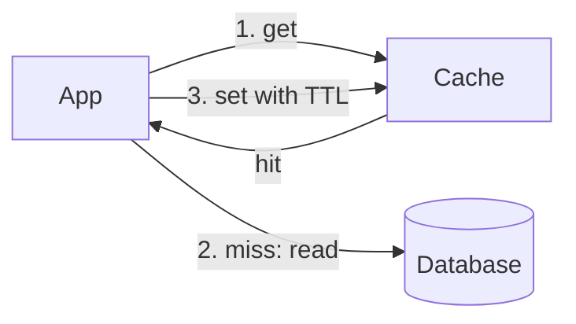

Cache-aside puts a fast store beside the database, and the application, not the store, decides what goes in it.

## Use it when

- Reads outnumber writes, and the database CPU climbs with traffic.
- A small set of rows draws most of the reads, like a product page on launch day.
- A slightly stale answer is acceptable for a few seconds.

## How it works

On a read, the app asks the cache first. A hit returns at once. A miss reads the database, writes the answer into the cache with a TTL, and returns it. On a write, the app updates the database and deletes the cached key, so the next read refills it.

If 90% of reads hit, the database sees a tenth of the traffic. A rise from 90% to 99% cuts it tenfold again, so the last few points of hit rate are worth the most.

## What it costs

Data can be stale for as long as the TTL, and a deleted key can race with a slow reader that writes the old value back. A cold cache sends every read to the database at once, and a popular key that expires under load sends many readers to rebuild it together, which is a [cache stampede](/glossary/cache-stampede).

## In Quorum

Place a [Cache](/components/cache) in front of the Database and research [Caching](/research/caching). The Cache's default strategy is cache-aside, so the Design shows it with a TTL and a size.

::Design{id="cache-aside"}

The [Cache stampede](/incidents/stampede) incident shows the cold-cache problem, and [Stampede protection](/research/stampede-protection) is the fix. The glossary defines [cache-aside](/glossary/cache-aside).
