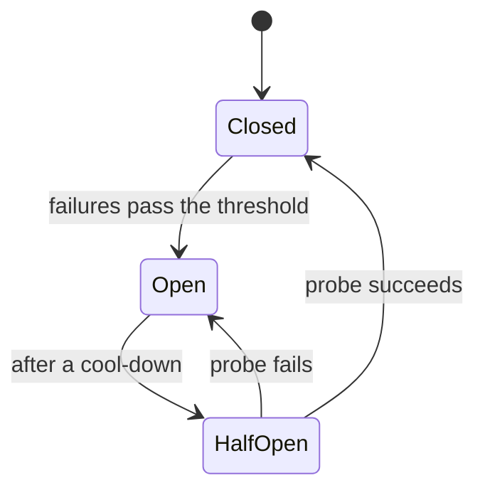

A circuit breaker stops a caller from hammering a dependency that is already failing.

## Use it when

- A dependency can fail for minutes, not milliseconds.
- Callers pile up waiting on it, and the pile starts to hurt services that did nothing wrong.
- You have a sensible fallback: a cached value, a default, or a clear error.

## How it works

The breaker counts recent calls and sits in one of three states.

Closed passes every call. Open fails every call at once, without touching the dependency. Half-open lets one probe through. Once failures pass a threshold, such as half of recent calls, the breaker opens for a few seconds. Callers get an instant error instead of a 30-second wait, and the dependency gets quiet time to drain.

## What it costs

The thresholds are guesses. A breaker that trips too easily cuts off a healthy service, and one that trips too late protects nothing. An open breaker also means some users see the fallback while the dependency would have answered a few of their calls. Use one breaker per dependency, never one for everything, or one bad service blocks all the others.

## In Quorum

::Design{id="breaker-on"}

The Design repeats the backoff Link from [Retry with backoff](/patterns/retry-with-backoff) and adds **Breaker**. The caption matches the backoff Design, because a breaker acts over time: the Simulation opens it on the Step after the Link's failure share passes the breaker's threshold, and a single solve of the steady state cannot show that. In play, the open Link fails calls at once for a few seconds, then tries again, and the Database gets quiet time to drain.

Pick **Breaker** on a Link after researching [Circuit breakers](/research/circuit-breakers), which needs [Backoff with jitter](/research/backoff-jitter). A Service Mesh runs its own breaker on each Link out of a Node with a sidecar. [Stop a retry storm](/guides/stop-a-retry-storm) uses it. The glossary defines [circuit breaker](/glossary/circuit-breaker) and [cascading failure](/glossary/cascading-failure).
