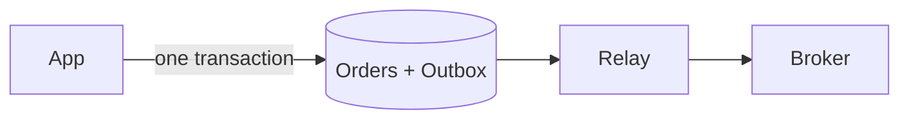

The transactional outbox makes "save the order and announce it" one atomic step.

## Use it when

- A change in your database must also produce a message, such as `OrderPlaced`.
- Losing the message or sending a message for a rolled-back change would corrupt another service.

## How it works

The naive code saves the row, then publishes to the broker. If the process dies between the two, the row exists and no one hears about it. Swap the order and a failed save leaves a message about nothing. The two systems cannot share one transaction.

So the app inserts the event into an `outbox` table inside the same transaction as the order. A relay process reads new outbox rows and publishes them, then marks them sent. A crash after publishing and before marking sends the event twice, so consumers must handle duplicates.

## What it costs

Events arrive a little later than the commit, because the relay polls or tails the log. You run and watch one more process, and the outbox table needs cleanup. Delivery is at-least-once, so [idempotent consumers](/patterns/idempotency-keys) are required.

## In Quorum

::Design{id="outbox-search"}

The other Nodes in the picture only serve the other request kinds of Series B, such as checkouts and realtime. Research [Transactional outbox](/research/outbox) and the game stops counting the dual-write loss: from Series B, a share of search answers is stale when the app writes to the Database and the [Search Engine](/components/search) separately and nothing carries the change. The outbox is a Research, not a Node, so the Design shows only its effect and has no setting of its own. A [CDC Connector](/components/cdc) removes the same loss by reading the Database log, which [Change data capture](/patterns/change-data-capture) covers. The glossary defines the [transactional outbox](/glossary/transactional-outbox).
