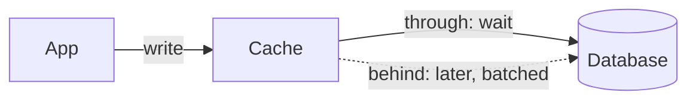

A write-through cache writes to the database before it answers, and a write-behind cache answers first and writes later.

## Use it when

- Cache-aside leaves users reading old rows right after a write, and you can see it in stale-read reports.
- Writes to the same few keys arrive in bursts, so batching them would save database work (write-behind).
- The data tolerates a short loss window if the cache dies (write-behind only).

## How it works

With write-through, the app writes to the cache, the cache writes to the database, and only then does the call return. The cache never disagrees with the database, so reads need no invalidation. With write-behind, the cache acknowledges at once and flushes batches to the database on a timer. A counter bumped 100 times in a second can reach the database as one update.

## What it costs

Write-through adds the cache's write time to every write and fills the cache with keys nobody reads. Write-behind is faster and cheaper on the database, but a crash loses whatever was not flushed yet, and the database lags the cache in the meantime. Use it for counters and likes, never for payments.

## In Quorum

The [Cache](/components/cache) has a Cache strategy option, and picking anything but cache-aside needs [Cache strategies](/research/cache-strategies). The two Designs below differ from cache-aside only in the strategy, so their captions show what it changes.

::Design{id="cache-write-through"}

::Design{id="cache-write-behind"}

The [Stale reads](/incidents/stale-read) incident shows why the strategy matters. The glossary defines [write-through cache](/glossary/write-through-cache).
